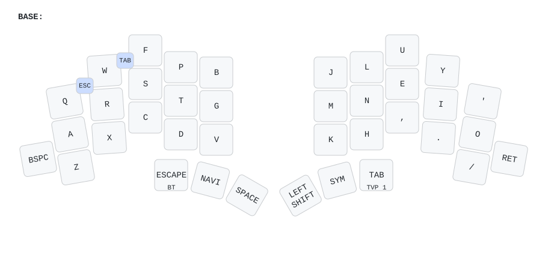
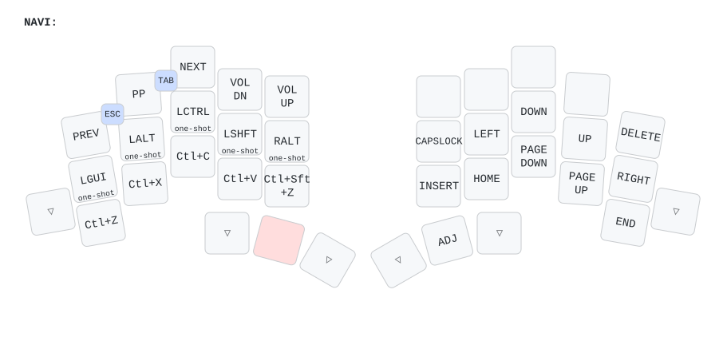

<picture>
  <source media="(prefers-color-scheme: dark)" srcset="/docs/images/TOTEM_logo_dark.svg">
  <source media="(prefers-color-scheme: light)" srcset="/docs/images/TOTEM_logo_bright.svg">
  
</picture>

# ZMK CONFIG FOR THE TOTEM SPLIT KEYBOARD

[Here](https://github.com/GEIGEIGEIST/totem) you can find the hardware files and build guide.\
[Here](https://github.com/GEIGEIGEIST/qmk-config-totem) you can find the QMK config for the TOTEM.

TOTEM is a 38 key column-staggered split keyboard running [ZMK](https://zmk.dev/) or [QMK](https://docs.qmk.fm/). It's meant to be used with a SEEED XIAO BLE or RP2040.

## KEYMAP

Colemak-DH on the base layer. Modifiers are one-shot keys on the nav layer, not home-row mods. Tap a modifier and it stays armed until the next key, including after you release nav or hold another layer. Holding a modifier still chords it. An unused tap drops after 5 seconds and is never sent, so a stray GUI tap does not open the OS menu. The plain Super key on nav (D) is the one that taps Super by itself.

The previous home-row version is on the `homerow-mods` branch.

Thumbs, from the left: Esc (hold for Bluetooth), Nav, Space, Shift, Numbers, Tab (hold for the function keys).

- **Nav** — one-shot GUI, Alt, Ctrl, Shift, and AltGr on the left home row. Above them: previous, play/pause, next, volume down, volume up. Below them: Ctrl+Z/X/C/V and Ctrl+Shift+Z. Arrows, home, end, and page keys are on the right. Delete is the top-right key.
- **Numbers** — numpad on the left, backslash at the lower left, one-shot Shift, Ctrl, Alt, and GUI on the right home row.
- **Symbols** — hold Nav, then hold the Numbers thumb. `/` taps slash and holds Shift. `=` taps equals and holds Nav. The key beside `$` types `->`, Shift types `=>`, Alt types `<->`, and Shift+Alt types `<=>`.
- **Combos** — Q+W is Esc. W+F is Tab.

Diagrams for each layer are in [docs/keymap](docs/keymap).

## HOW TO USE

- fork this repo
- `git clone` your repo, to create a local copy on your PC (you can use the [command line](https://www.atlassian.com/git/tutorials) or [github desktop](https://desktop.github.com/))
- adjust the totem.keymap file (find all the keycodes on [the zmk docs pages](https://zmk.dev/docs/codes/))
- `git push` your repo to your fork
- on the GitHub page of your fork navigate to "Actions"
- scroll down and unzip the `firmware.zip` archive that contains the latest firmware
- connect the left half of the TOTEM to your PC, press reset twice
- the keyboard should now appear as a mass storage device
- drag'n'drop the `totem_left-xiao_ble-zmk.uf2` file from the archive onto the storage device
- repeat this process with the right half and the `totem_right-xiao_ble-zmk.uf2` file.